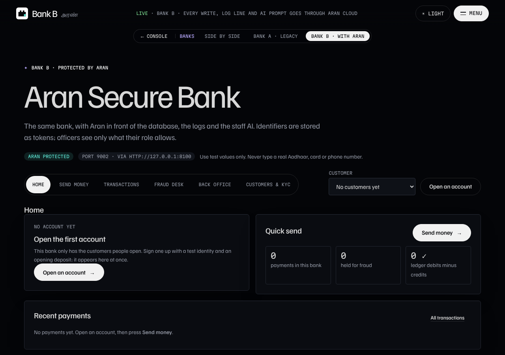
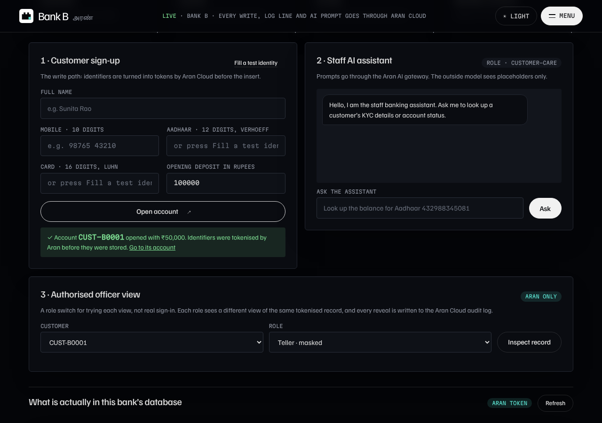
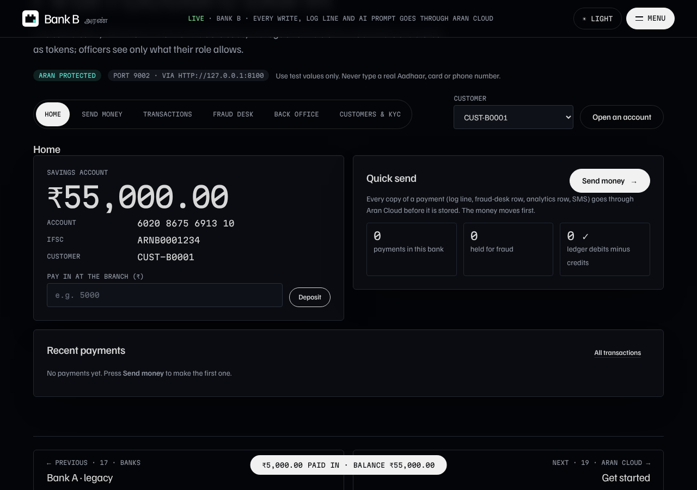
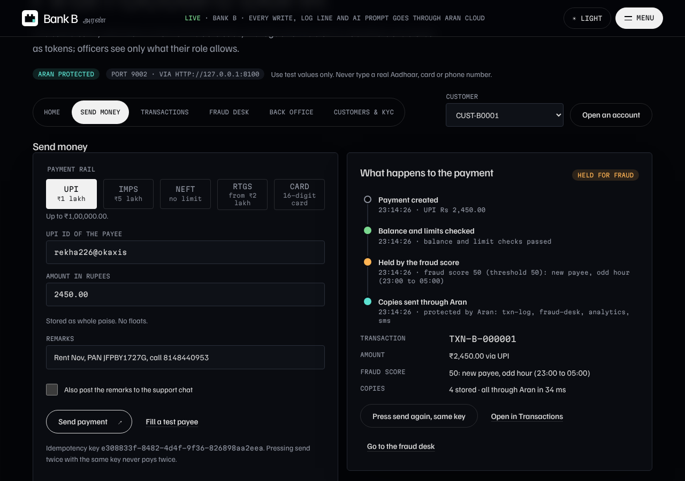
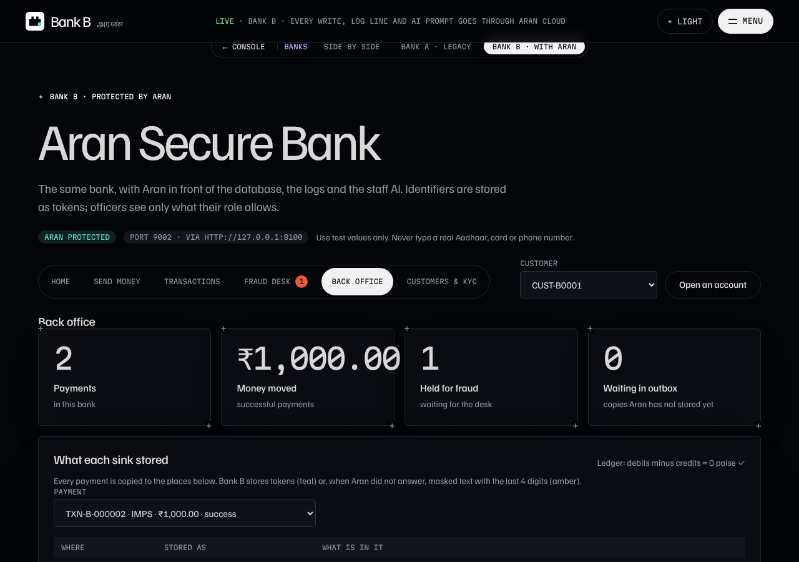
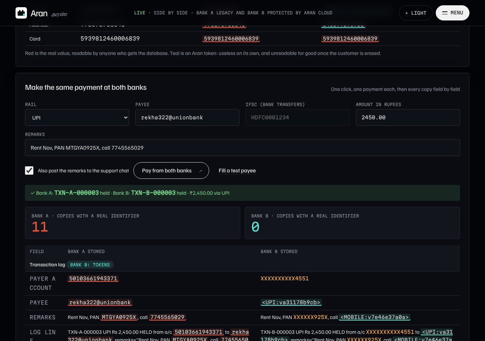
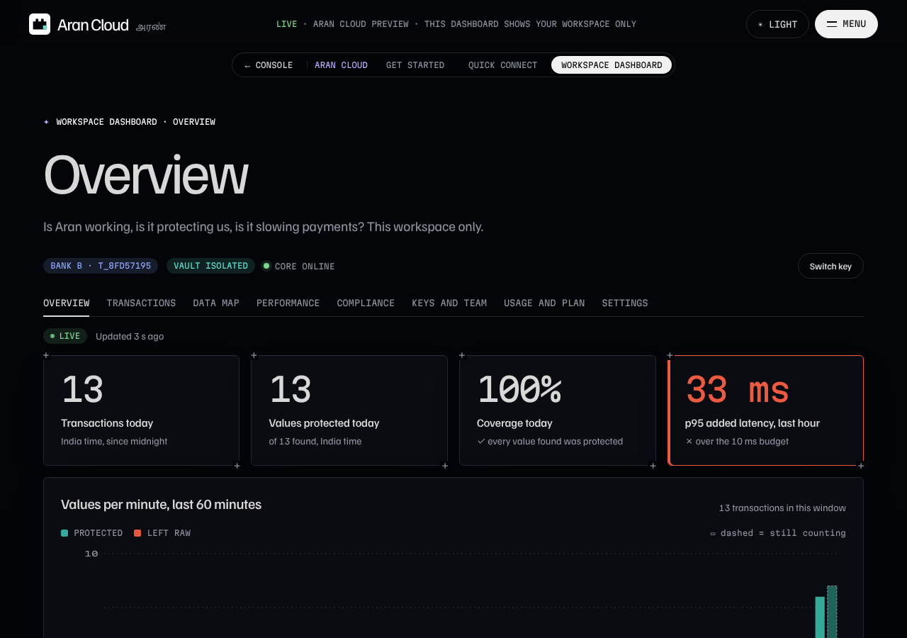
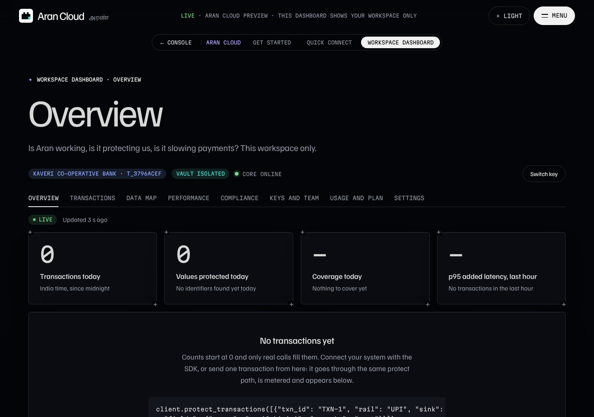
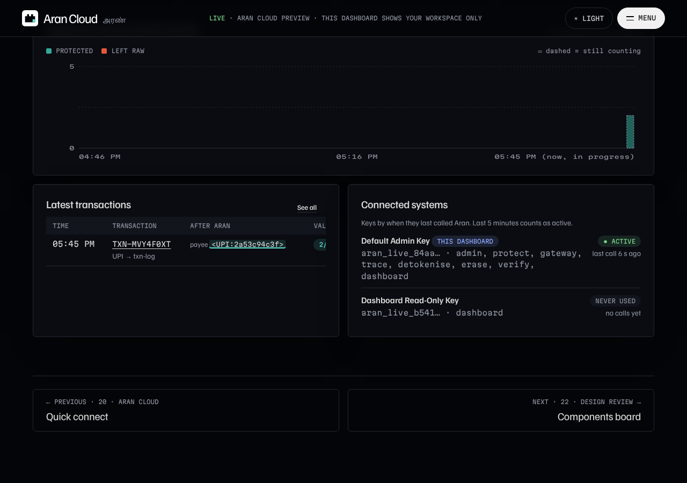
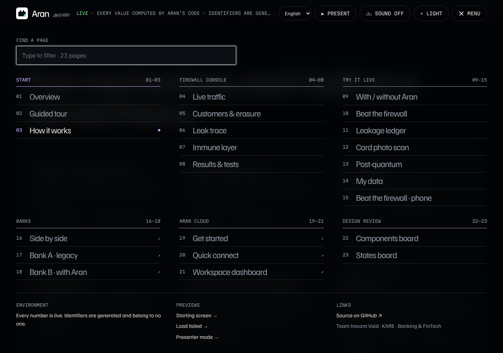

# Aran: Every Feature Works for Real

What changed so that no page of the console, Aran Cloud, Bank A or Bank B shows made-up data, and every button goes through the real back end. Read [Learn 29](Aran%20Learn%2029%20-%20Real%20Data%20Paths%2C%20Not%20Demo%20Data.md) first if you are new to this.

## 1. What was fake, and what replaced it

| Where | Before | Now |
|---|---|---|
| Aran Cloud dashboard | **Add demo transactions** wrote 200 made-up payments, labelled "demo" | Removed, with its `/v1/demo/seed` endpoint and `scripts/seed_demo.py`. An empty workspace shows a short form: type one transaction and it goes through the real `/v1/transactions/protect` path, is metered and appears in the feed. Bank B's real payments fill Bank B's workspace on their own. |
| Bank A and Bank B | A timer made a random payment every 15 seconds (`BANK_AUTO_TRAFFIC`) | Removed. Payments only come from people pressing **Send money** (or the side-by-side page). |
| Bank A and Bank B | **Run the day** made 20 random payments | Removed, with `/api/simulate`. The button is now **Open an account**. |
| Bank A and Bank B | The server created 8 customers on start, each with a random balance of Rs 1 to 10 lakh | Removed, with `/api/seed`. A bank starts with no customers. You open accounts on **Customers & KYC** and type the **opening deposit**. |
| Bank A sign-up | "Fill a valid sample" asked a server that does not exist on the hosted site, then fell back to one hard-coded identity, so every hosted sign-up got the same Aadhaar | **Fill a test identity** makes a fresh checksum-valid identity in the bank itself (Verhoeff Aadhaar, Luhn card, Indian mobile) on every press. |
| Console presenter mode | When the server was down it replayed answers saved earlier and the page still looked live | Removed. The page says the server is waking or reconnecting. The old offline service worker removes itself. |
| Console normal traffic | One replayed log line in ten had a made-up customer event added | Removed. The replay is the real Loghub production logs, exactly as logged. |
| Wording | "Demo banks", "Live demos", "Demo bank", "Mock bank", "demo data" | "Banks", "Try it live", "Bank A", "Bank B", and plain words for what the page does. Tamil and Hindi updated too (check-i18n: 147/147). |

Test identities are still generated on purpose: nobody should ever type a real Aadhaar, PAN or card number into this site. The flow they go through is real.

## 2. Bugs fixed

1. **Normal traffic stopped for good after an erasure.** Live server logs showed `KeyError: 'AADHAAR'` in the replay thread: once a customer was erased, the thread crashed and never restarted, while the page still said "Normal traffic is on". The line that caused it is gone, and one bad line can no longer stop the thread.
2. **A transfer to another customer of the same bank vanished.** Paying a Bank B account number with Bank B's own IFSC took the money out of the payer and put it in the settlement account, so the payee never got it. Now a bank transfer (IMPS, NEFT, RTGS) to the bank's own IFSC lands in the payee's account, an unknown account number fails with a clear reason, and a reversal takes the money back from the payee. The ledger still sums to zero.
3. **The side-by-side payment needed seeded customers.** It paid from "the first customer" of each bank. It now pays from the customer you just signed up at both banks (or the newest open account), and says what to do when a bank has no account yet.

## 3. New, small, real features

- **Opening deposit** on the sign-up form (Rs 0 to 1 crore).
- **Pay in at the branch** on Home: a deposit into the selected account (`POST /api/accounts/{ref}/deposit`).
- **Send one real transaction** from an empty Aran Cloud dashboard.

## 4. How it was checked

- A browser run of the whole journey on all four apps (`journey.js`, Playwright): empty bank, open two accounts with typed deposits, branch deposit, UPI payment, same-bank IMPS transfer (approved on the fraud desk when held late at night), every bank page, staff AI chat, breach dump and trace, side by side sign-up and payment, Bank B's Cloud dashboard showing the real payments with no "demo" anywhere, a new Cloud workspace sending its first transaction, presenter mode, every console page and the menu. All steps pass with **no console errors and no failed requests**.
- Tests: bank transactions 47 passed (new: the bank creates nothing on its own, opening and branch deposits, fresh test identities, same-bank transfer and reversal), Aran Cloud transactions and security, core and SDK 47 passed (the one lockdown test that fails also fails on `main` when the core runs with the console open, as it does locally), core smoke test 11/11, bank smoke test 9/9.

## 5. What stays as it is

- **Free hosting forgets.** Render's free plan has no disk that survives a restart, so the banks and Aran Cloud start empty after a restart or a deploy. That is the host, not fake data; a paid disk or a hosted database would keep it.
- **The console's own test customers.** The firewall console (`aran-console`) enrols a few generated customers when it starts, because its tour, drills, ledger, versus and "My data" pages are built on them. Their numbers are generated and belong to no one, the same rule as the banks' test identities.
- **The AI chatbot** uses the gateway's echo stand-in unless `ARAN_LLM_URL` (or an Anthropic key) is set on the server. The page shows exactly what the provider saw either way.

## Screenshots

| | |
|---|---|
|  A new bank has no customers and says how to start |  Opening an account with a test identity and a typed deposit |
|  Home with the branch deposit |  A payment going through, step by step |
|  Back office: every copy of a payment |  Same customer and payment at both banks |
|  Bank B's Cloud workspace, filled only by real payments |  A new workspace starts at 0 |
|  After sending its first transaction |  The menu: Try it live, Banks |
